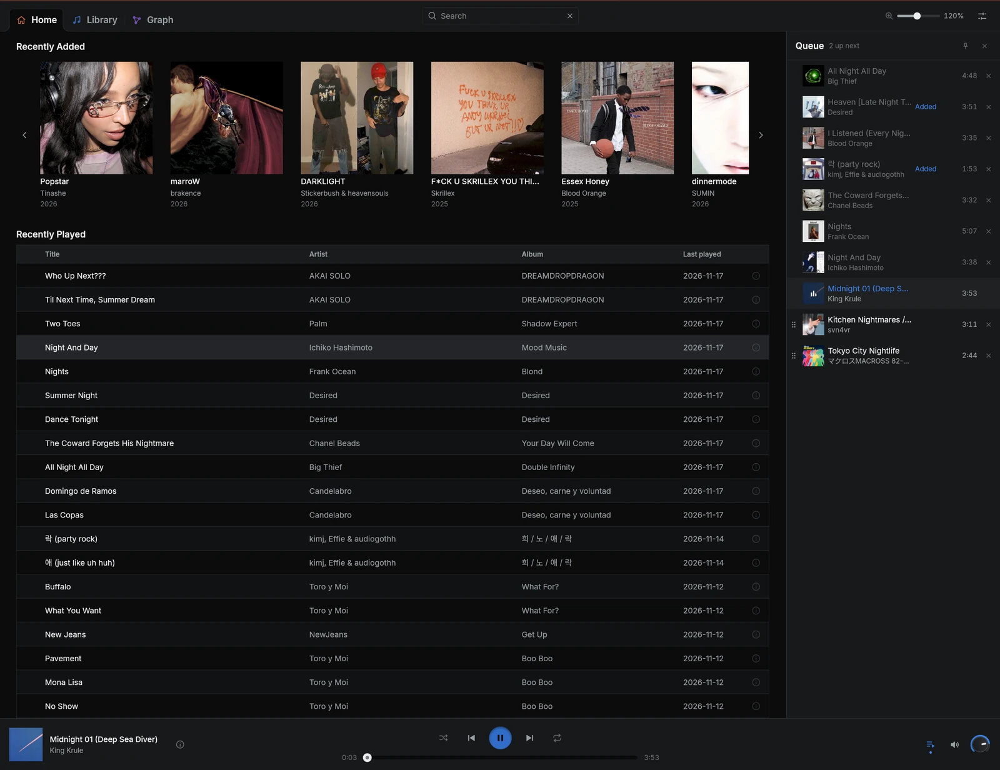

# Peri

A cross-platform desktop music player written in Rust and built with 
[Rune](https://github.com/anomalyco/rune). Inspired by Obsidian's "file over app"
philosophy, scanning tags from your music library directly. I've also borrowed 
their Bases design for building dynamic views, with different modes. The graph 
view reveals connections between artists and their collaborators.

My goal with this project was to make a music player that would make it easy to
see all the people credited on songs. [MusicBrainz Picard](https://picard.musicbrainz.org/)
makes it easy to add the appropriate credit tags to your library, so this builds 
on that and lets you make the most of this information. 

Other Rust libraries in use include [rodio](https://github.com/RustAudio/rodio) for 
audio playback, and [lofty](https://github.com/Serial-ATA/lofty-rs) for parsing 
tags/album art. 

## Screenshots




The following text is purely AI generated. I intend on writing proper documentation
myself once this is further along, but the information below is accurate at least.

## Run

```sh
cargo run --release                     # scan the saved library folders (see Settings)
cargo run --release -- ~/Music          # scan these instead, for this run only
```

On Linux, building needs `libxkbcommon`, `wayland` and `alsa-lib` (PipeWire works through `pipewire-alsa`).

## Features

- Recursive folder scan on a background thread. It reads mp3, flac, ogg, wav, m4a/aac, aiff and caf files.
- The library folders are remembered. **Open folder…** (Ctrl+O, or the button on an empty library) replaces them, and dropping folders or files on the window adds to them. Both are scanned at every launch.
- **Settings** (the sliders button, top right): see the library folders, add or remove one, rescan, or **Forget library**. A folder that can't be found (an unplugged drive) stays saved, is marked *Not found*, and is scanned again once it's back.
- **Home** tab (left of Library): the 20 newest albums in one row of cards, and the 20 songs played last. Double-click a song to play from there.
- The open tab (Home, Library or Graph) is remembered across launches.
- **Settings → Appearance** picks the theme (Bolis, or Peridot: greens inspired by the gemstone) and the mode: Light, Dark or System (the default). They're saved under `theme` and `appearance` in `prefs.json`.
- Search across title, artist and album.
- A virtualised track list, so large libraries scroll smoothly.
- A now-playing bar with cover art (embedded, else `cover.jpg`/`folder.jpg` next to the file).
- Play/pause, previous/next, a seek bar, volume and mute, shuffle, and repeat (off/all/one).
- **The queue** (the Queue button in the bar, or Q) lists what plays next, with the songs already played above the current one. It floats over the page, or **pin** it to dock it beside the page; a pinned queue opens at launch. Double-click a row to play it, drag a grip to reorder the upcoming songs, and × removes a row. Double-clicking a song in a list starts a new queue from it.
- Right-click a song, album or album card for **Play Next** (right after the current song) or **Play After** (at the end of the queue). A song's menu also has **Song details**.
- Starting a new list over a queue you've edited asks first: **Replace queue** drops the upcoming songs, **Keep added songs** keeps the ones you added. **Don't ask again** remembers the answer. **Settings → Queue** sets it outright (Ask, Replace queue or Keep added songs).

## Last.fm scrobbling

- **Connect:** in **Settings → Last.fm** press **Connect Last.fm**, allow access on the page that opens in your browser, then press **Finish connecting**.
- **The app's API account:** Last.fm signs every request with an API key and shared secret. They're read at build time and never committed:

  ```sh
  PERI_LASTFM_API_KEY=… PERI_LASTFM_SECRET=… cargo build --release
  ```

- **Builds without a key** (built from source without the variables) ask for the user's own instead: create an API account at <https://www.last.fm/api/account/create> and paste its API key and shared secret before connecting.
- **Changing keys:** a session belongs to the API key it was granted to. When the key in use changes (a new built-in key, or a user's key replaced by a built-in one), the saved session is dropped and Settings asks to connect again.
- **What's sent:** "now playing" when a song starts, and a scrobble once it has played for half its length or four minutes, whichever comes first. Songs of 30 seconds or less, and songs without an artist tag, aren't scrobbled. Seeking ahead doesn't count as listening.
- **Tags:** the artist tag as written ("A & B feat. C"), the title, album, album artist (when it differs), track number, length and MusicBrainz recording ID.
- **Failures:** a scrobble that fails or that Last.fm ignores shows an error and is dropped, not retried. If Last.fm stops accepting the session (access revoked), the app disconnects and asks you to connect again.
- **Saved:** the session key, user name and the API key it belongs to are kept unencrypted under `lastfm` in `prefs.json`, with the user's own API key and secret in builds without one. The built-in key is never saved. **Disconnect** forgets the session; **Remove credentials** (only in builds without a key) forgets the user's key too.
- Headless runs (`--snap`, `--script`) and tests never contact Last.fm.

## Play counts

- **What counts:** the same rule as scrobbles. A song counts once it has played for half its length or four minutes, whichever comes first. Paused time and seeking ahead don't count, and songs of 30 seconds or less never count. Last.fm doesn't need to be connected.
- **Where they show:** the **Plays** and **Last played** properties (columns, sort, filter, group), and song details. Albums add up their songs' plays and take the latest last played.
- **Copies:** copies of one song share its plays. They match by MusicBrainz recording ID, else artist, title and album ignoring case, else the file path.
- **Saved:** each play is a line (time, path, recording ID, artist, title, album) appended to `plays.jsonl` next to `prefs.json`. Counts are tallied from it at launch. A line that can't be read is skipped and reported. Headless runs and tests keep plays in memory.

## Views, filters and grouping

A view is a saved query over the library: a filter, sorts and an optional grouping (the design follows Obsidian's [Bases](https://help.obsidian.md/bases/views)). By default a view lists every song in a flat list. Change it from the toolbar under the header:

- **Views** (top left): create, rename (double-click or ✎), duplicate, delete and switch views. Each view keeps its own filter, sorts and grouping. ▶ plays a view without opening it.
- **Play** (▶ and the song or album count): plays the view's songs in its order, collapsed groups included; an album view plays its albums' songs album by album. It's dimmed while the view is empty.
- In a narrow window, Columns, Sort, Group and Filter show only their icons, with the full label as a tooltip.
- **Sort:** add several sorts and reorder them with ↑. Each sorts A→Z / 0→9 / old→new or the reverse. Songs missing a value always go last.
- **Group:** group by one property into sticky headers with counts. Click a header to collapse it. Songs with several artists, album artists, genres or composers show under each, so a collaborative album shows under each of its artists.
- **Filter:** add conditions (property, operator, value) to a group whose rule is *all*, *any* or *none* of the following are true. Groups nest up to three levels. The operators offered depend on the property type:
  - text: is, contains, starts with…
  - lists: has, does not have…
  - numbers: = ≠ < ≤ > ≥
  - dates (`YYYY-MM-DD`): before, after…
  - durations (`m:ss`): = ≠ < ≤ > ≥
  - any property: is empty / is not empty

  A condition with no value yet, or one that can't be read (a word where a year goes, shown in red), filters nothing out.

Properties: title, artist, featured artist, album artist, album, genre, year, the credit roles (composer, lyricist, writer, producer, arranger, conductor, performer, engineer, mixer, remixer, DJ mixer), label, track and disc number, duration, format, folder, date added, plays and last played. Year comes from the recording date tag, else year, release date or original release date. Date added is the file's creation time.

## Columns and song details

- **Columns** (toolbar): pick which properties song tables show after the title, and move them left with ↑. Each view keeps its own; album and artist pages share one set. Names in artist and credit columns open the artist's page. When the columns need more room than the window has, the table scrolls sideways under a header that follows.
- **Song details:** the ⓘ button on a row, next to the playing song, or I for the selected song opens a dialog with everything about the song: artists, release, credits by role, the file (path, format, bitrate, sample rate, bit depth, channels, size) with an **Open containing folder** button, MusicBrainz IDs and ISRC, lyrics, and **All tags**, every tag exactly as the file stores it. The file is read when the dialog opens. Esc closes it.

Search narrows the current view further, and Next/Previous follow the view's order. In a grouped view, a song that appears in several groups plays once, in its first group.

Views save on every change to `prefs.json` in the app's config folder:
- Linux: `~/.config/peri/`
- macOS: `~/Library/Application Support/peri/`
- Windows: `%APPDATA%\peri\`

Collapsed groups are not saved.

## Albums

Each view lists either **Songs** or **Albums**; switch with the toggle in the toolbar.

- **What counts as one album:** songs with the same album artist (else track artist), album title and year, ignoring case. The same title from two years is two albums, while multi-disc and multi-folder albums merge.
- **Songs without an album tag:** they gather per artist under "Unknown album".
- **Layouts:** album views have **Grid** (covers) or **List** (a card per album with its track table).
- **Card size:** the slider next to Grid/List sizes the grid's cards (120–320 pt covers), and the columns refit. Each view keeps its own size once dragged; **Set as default** makes it the size views without their own use, and double-clicking the slider puts the view back on the default.
- **Filter, sort and group:** these work on album properties: title, album artist, artists, genres, year, composers, label, track count, total duration, formats, folder and date added. For example, sort by album artist to keep each artist's albums together.
- **Search:** finds albums by title or artist, or albums that contain a matching song.
- **Album page:** click a grid card, or a list card's cover or title, to open it. It has the cover, details, Play and Shuffle, the tracks grouped by disc, and "More by" the same artist. Esc or Back returns to the list. Clicking the cover in the now-playing bar opens the playing album.
- **Playback:** a card's play button, Play album, or double-clicking a track plays that album and then continues through the next albums in the view's order.
- **Covers:** read from the first song of each album (embedded art, else `cover.jpg`/`folder.jpg`). They're shrunk to 480 px on background threads, and at most 160 are kept in memory.
- **Saved settings:** the mode and layout save with each view. Views saved before this change load as song views.

## Keys
### Labels

A label name opens the label's page wherever it's shown: the album page's facts, the Label column of song tables, and song details. The page lists every album released under the label (newest first, grouped into Albums, EPs, Singles and Compilations) with counts and a Play button that plays them all newest first. Names match ignoring case, and the label comes from the first song of each album that has a `LABEL` (else `PUBLISHER`) tag.

### Artists

Every artist name is a link: in song rows, titles ("Calypso Gene (feat. Silka & Cleo Reed)"), the now-playing bar, album cards and album pages. It opens the artist's page: their albums, albums they appear on, songs crediting them (composer, lyricist, producer, performer…), then their own songs. When they have credits, their songs start collapsed under a Songs heading; click it to open. Song rows there lead with the album cover. Back and Esc retrace the pages visited, and returning to the library puts the list back where it was scrolled (Home opens it at the top).

- **Who's who:** the `ARTISTS` tag (one value per act) with the MusicBrainz artist IDs names each artist. The artist tag ("A & B feat. C") and the title ("(feat. C)") say who is featured.
- **Collaborative albums:** MusicBrainz album artist IDs are matched to names anywhere in the library, so "Armand Hammer & The Alchemist" counts as an album of each.
- **Collaborations:** in a line naming several artists ("Armand Hammer & The Alchemist"), the `&` (or `,`, `x`, `and`…) between the names opens their collaboration page: albums whose album artists include all of them (newest first), then "Together on", songs elsewhere naming all of them as artists. In "A & B feat. C" it covers the main artists only. Each name in the page's title opens that artist's page, and merged names count as the artist's.
- **Files without those tags:** the artist text is split at `feat.`/`ft.`/`featuring`. Main artists split at `&`, `,`, `x`, `and` only when every piece is a name the library already knows, so "Simon & Garfunkel" stays whole.
- **Credits:** composer, lyricist, writer, producer, arranger, conductor, performer (with instrument), engineer, mixer, remixer and DJ mixer tags. Album pages list them.

### Related artists

On an artist's page, **Link artist** opens a popover: pick **Same artist** (merge), **Alias**, **Member of** or **Has member**, then type a name. Names the library knows are suggested; Enter or **Add "…"** links a name it doesn't have yet, which turns into a link once music under that name arrives. The ✕ on a related artist removes the link, and the ✕ on a name under "Also credited as" takes it out of the merge. Changes save at once.

They're saved under `artists` in `prefs.json`, which can also be edited by hand while the app is closed:

```json
"artists": {
  "merges": [["Earl Sweatshirt", "Thebe Kgositsile"]],
  "links": [
    { "from": "MF DOOM", "kind": "alias", "to": "Viktor Vaughn" },
    { "from": "billy woods", "kind": "member_of", "to": "Armand Hammer" }
  ]
}
```

- **Merges:** names of one artist. Any of them opens one page gathering everything each is credited with. It's named after the most prominent name (album artist outweighs artist, then featured, then other credits), with "Also credited as" listing the rest. Merges only affect artist pages, not views, filters or grouping.
- **Links:** artists that keep their own pages. Each page lists the other under **Related**: `alias` shows as "Also releases as" on both, and `member_of` as "Member of" on the person's page and "Members" on the band's. Names the library doesn't have show but don't open a page.
- **Include aliases:** a page with aliases has an **Include aliases** checkbox next to Play. It adds everything released or credited under their aliases (and aliases of those) to the page, with album cards naming each album's artist, and Play and Play Discography follow it. It stays on from page to page until unticked or the app restarts.
- **Bands and members:** a `member_of` link also gets a collapsed section per band ("With …") or member ("… (solo)") on the page, with their releases, appearances and credits. **Play Everything** plays the page's music, then each of those sections' music once. Both follow **Include aliases**.
- Names match ignoring case. If the `artists` entry can't be read (a typo in a key or kind), the app says so and ignores it.

## Graph

The **Graph** tab (next to **Library** at the top left) shows every artist in the library as a dot, joined by a line to each artist they've worked with. Dots grow with how many artists they're linked to.

- **Links, colour-coded:**
  - your artist relations: **Same artist** (merged names, each still its own dot), **Alias** and **Member of**;
  - from the tags: **Featured** (a guest on another artist's song), **Together** (main artists of the same song) and one per credit role (**Producer**, **Composer**, **Performer**…: someone credited on another artist's song).
- **Legend:** each kind in the graph has a chip; click it to hide or show those links.
- **Moving around:** drag (or middle-drag) or scroll with a trackpad to pan; pinch, Ctrl + scroll or a mouse wheel to zoom about the pointer. **Fit** shows everything again.
- **Artists:** hover a dot for its name; click it to open the artist's page (Back or Esc returns to the graph). Names show for the most linked artists, and for more as you zoom in.
- **Links:** hover a line to light it and the two artists it joins, with what it says: "Kenny Segal produced 2 songs by billy woods", one line per kind when they're linked several ways.
- **Arranging by hand:** drag a dot to move it. Artists up to two links away follow on springs, keeping their shape, and settle after you let go; the rest stay put, so dragging costs the same in any library. A dropped artist is pinned (a small blue dot at its top right): new layouts, after music or links are added, leave it where you put it. Right-click a dot to unpin it (or open the artist), and **Reset layout** unpins everyone and arranges the graph from scratch.
- **Find an artist:** type to centre the best match and highlight who they're linked to; Enter opens their page, Esc clears it.
- **Saved:** the camera and hidden link kinds save under `graph` in `prefs.json`. The layout, with what you've pinned, is cached in `graph-layout.json` next to it and reused while the artists and who's linked to whom stay the same; when music or links are added, the artists already placed keep their places and the new ones settle in around them on a background thread.

## Keys

| Key | Action |
| --- | --- |
| Space | Play / pause |
| ← / → | Seek 5 s |
| Ctrl+← / Ctrl+→ | Previous / next track |
| ↑ / ↓, Enter | Move the selection, play it |
| Ctrl+F or / | Search (Esc clears it, Enter plays the first match) |
| Ctrl+O | Open a folder |
| Ctrl+= / Ctrl+- / Ctrl+0 | Zoom in / out / back to 100% |
| S / R / M / Q | Shuffle / repeat / mute / the queue panel |
| I | Song details for the selected (else playing) song |
| Esc | Close a toolbar popover, the queue panel or the details dialog, or go back from an album or artist page |

Double-click a row to play it. Ctrl is Cmd on macOS.

**Queue:** the queue saves to `queue.json` beside `prefs.json` on every change: its order, which songs were added or moved or removed, the place it's at and how far into the song. Play restores it paused at that second. The pin is saved in `prefs.json` as `queue_pinned`; whether the panel is shown is not, so a floating panel starts hidden. If the playing song leaves the library, the queue stops and its file is deleted.

**Zoom:** the slider in the header (or the keys above) zooms the whole window from 50% to 200%; click the level to reset it. A window too small for the zoom draws at what fits (shown as "max …%") and keeps the zoom for when it's bigger. The zoom saves under `zoom` in `prefs.json`.

## Develop

```sh
cargo test                                                   # unit + headless UI tests
PERI_MUSIC_DIR=~/Music cargo test --release real_library -- --ignored --nocapture
PERI_MUSIC_FILE=song.flac cargo test --release real_output -- --ignored   # plays muted
PERI_MUSIC_DIR=~/Music cargo test --release real_library_groups -- --ignored --nocapture
cargo run -- --snap out.png --scene playing --theme light    # scenes: library playing search error grouped filter views sort albums album-list album artist related link label collab graph home queue queue-pinned
```

Headless runs (`--snap`, `--script`, `--tree`) never open the audio device and keep views in memory.
